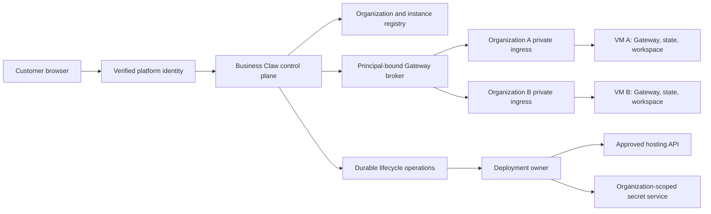

# Business Claw: managed-service architecture proposal

31 October 2026 (Europe/Rome). **Product decision: managed service, with an isolated Gateway per customer organization. Operational design: proposed, not activated.**

This follows [the retained brief and selected product direction](../spec.md). The owner's “I approve. You choose.” approves Clero's separate 72-check scope and delegates the Business Claw variant choice. The selected variant closes the earlier managed-versus-internal question. It does not authorize a new identity policy, credential grant, database, dependency installation, hosting account, paid resource or Business Claw test run. No such action occurred here.

This document is the reviewable specification for the managed product. The initial source slice below is its control-plane foundation; it is not a substitute local configuration generator or evidence of a running service.

## Outcome and implementation decisions

A customer organization can set up its own hosted OpenClaw assistant through a short conversational flow, then use a clear settings/chat dashboard. The service owns the installation and recovery lifecycle. The customer should not need to operate a Linux server, edit arbitrary JSON5 or assemble an unrestricted provider/channel catalogue.

The retained Notion snapshot is unverified and truncated. Its concrete Business Claw requirements remain: thinner installation/setup, conversational configuration, fewer providers/channels, organization-first operation, remote Notion MCP, memory/self-building features, and clearer settings/chat. Comparison names and unread conversations add no requirements. The following are implementation decisions under the managed-service selection, not claims of additional owner instructions:

| Product capability | Required managed behavior |
| --- | --- |
| Organization setup | Create an organization-scoped desired setup, explain its capabilities/cost prerequisites, obtain the applicable confirmations, provision its isolated runtime, and show actual readiness or a recoverable failure. |
| Conversational configuration | Turn conversation into a reviewable typed intent and redacted diff. Validate against the selected runtime's schema; saving a draft is distinct from applying configuration. |
| Smaller catalogue | Start with in-app web chat and one deliberately supported model-provider entry. Keep one external team-channel adapter as a named capability, disabled until its account/policy is approved. Unsupported choices stay visibly unavailable rather than silently falling back. Exact provider/channel bindings remain proposed. |
| Remote Notion MCP | An organization-owned connector reaches an explicitly approved remote Notion MCP endpoint with its own consent and credential lifecycle. The dashboard shows connected, revoked, expired and unavailable states. |
| Memory | Review organization memory, its sources and retention; preserve durable files separately from derived indexes. Do not treat recalled approval text as an executable permission grant. |
| Self-building | The organization agent can create and revise organization-owned project artifacts in an isolated workspace, expose a diff and evidence, and request activation. It cannot rewrite the shared SaaS control plane, hosting policy or its own deployment authority. |
| Dashboard | Show setup progress, current runtime/version, desired versus applied configuration, chat/session state, connector health, memory, pending changes, and explicit pause/export/deletion controls. A generic HTTP success is not “assistant ready.” |

The product is incomplete until these capabilities work together on actual isolated organization runtimes. Authored fixtures, a landing page, a config export, or a UI backed only by memory are insufficient.

## Upstream facts that constrain this design

All upstream references below are pinned to OpenClaw [`8034bb1fafbe83e5ce95fc985686bc2f95ff5ce1`](https://github.com/openclaw/openclaw/tree/8034bb1fafbe83e5ce95fc985686bc2f95ff5ce1). This is the inspected source identity, not a qualified production image or a floating dependency version.

- A Gateway serves a mutually trusting operator/team boundary. Operator roles and session IDs do not provide isolation between hostile customers; tool-enabled agents can have Gateway-wide session reach. Therefore organization separation must exist below the role/session layer. [Trust model, lines 11–23](https://github.com/openclaw/openclaw/blob/8034bb1fafbe83e5ce95fc985686bc2f95ff5ce1/docs/gateway/security/trust-model.md#L11-L23)
- Separate instances need distinct config, state, workspace and listener/service identities. A different state-directory value alone does not isolate an installed service. [Multiple Gateways, lines 85–120](https://github.com/openclaw/openclaw/blob/8034bb1fafbe83e5ce95fc985686bc2f95ff5ce1/docs/gateway/multiple-gateways.md#L85-L120)
- The runtime rejects unknown or invalid configuration. Use its authoritative schema and field lookup rather than inventing compatible-looking keys. [Configuration, lines 79–105](https://github.com/openclaw/openclaw/blob/8034bb1fafbe83e5ce95fc985686bc2f95ff5ce1/docs/gateway/configuration.md#L79-L105)
- Config tooling has revision hashes, partial patch semantics and application acknowledgments. A persisted revision can still be unapplied; replaying an unchanged patch does not necessarily recover activation. [Config RPC, lines 13–27 and 54–125](https://github.com/openclaw/openclaw/blob/8034bb1fafbe83e5ce95fc985686bc2f95ff5ce1/docs/gateway/configuration/config-rpc.md#L13-L27)
- A team deployment separates verified ingress identity, Gateway roles, publication credentials and channel identity. Proxy headers alone do not verify an identity-provider assertion. [Team server, lines 215–243 and 428–455](https://github.com/openclaw/openclaw/blob/8034bb1fafbe83e5ce95fc985686bc2f95ff5ce1/docs/gateway/team-server.md#L215-L243)
- SecretRefs reduce persisted plaintext; they do not isolate secrets from the same process or make readable credential files safe. [Secrets runtime, lines 38–67](https://github.com/openclaw/openclaw/blob/8034bb1fafbe83e5ce95fc985686bc2f95ff5ce1/docs/gateway/secrets/runtime-model.md#L38-L67)

## Trust and hosting boundaries

**Proposed isolation unit: one dedicated VM per organization, containing one production Gateway and its agent sandboxes.** This is a stronger boundary than separate profiles or several customer containers under one shared Gateway process. The VM provider, region, machine sizes, persistent-disk product, network and prices are not selected or provisioned by this document; the provider binding must satisfy the capabilities below and receive its separate hosting/security approval.

| Boundary | Proposed invariant and owner |
| --- | --- |
| Customer admission | The platform identity boundary authenticates the person and resolves membership server-side. A request body, organization header, email display name or session key cannot select or grant another organization's authority. |
| Organization → runtime | The registry maps an immutable organization ID to an instance ID, generation and owned provider resource IDs. The server selects the Gateway endpoint; clients cannot supply an arbitrary Gateway URL, token, filesystem root or provider resource ID. |
| Runtime → runtime | No shared home, writable volume, workspace, credential namespace, browser/CDP endpoint, agent database, vector index, bot identity or backup key between organizations. One org's processes cannot reach sibling runtimes or the management network. |
| Runtime → platform | The Gateway runs as an unprivileged service account. Agent tools run inside bounded workspace sandboxes, without the deployment API credential, host socket, platform database credential or control-plane filesystem. Host-level admin and customer agent work remain separate. |
| Ingress | The Gateway remains private/loopback behind the organization's authenticated ingress. No public unauthenticated WebSocket, machine-route bypass or browser-readable shared-owner secret. The ingress must authenticate HTTP, WebSocket and required transfer routes. |
| Platform maintenance | One lifecycle owner creates, updates, restarts and retires each installation. Agents and customer chat do not obtain hosting credentials or invoke a competing updater. Support access is explicit, time-bounded and audited; no default platform-support session-reading grant is proposed. |

Members inside an organization must be treated as one mutually trusting agent domain. Proposed UI roles can limit actions, but they do not promise adversarial per-member confidentiality. Private employee/personal Notion data must not enter that shared runtime without an explicit organization-sharing basis. A later private-user/trust-group product would need additional runtime separation, not a session-label convention.

The managed service needs an always-on worker/runtime and persistent storage. A serverless dashboard deployment alone does not host the Gateway. The required hosting contract includes private networking, per-org VM identity, isolated persistent disks, bounded compute/egress, encrypted off-host backups, observable lifecycle operations and a means to suspend/delete exact owned resources. No free-tier capacity or zero-cost assumption is made.

## Identity and permissions proposal

The following is a proposed new policy, requiring its own approval before enforcement or identity-provider configuration:

- **Owner:** organization membership and commercial/lifecycle decisions, including explicit deletion confirmation.
- **Administrator:** approved organization settings, connector management and reviewed configuration requests.
- **Member:** admitted chat and permitted organization work.
- **Viewer:** permitted read-only sessions and status; no agent work or configuration writes.

Platform membership and Gateway capability grants are different records. The broker must preserve a verified person for admitted conversation/session work and map to a reviewed upstream role ceiling. It must not turn every customer into `operator.admin`, use one shared owner token for all users, or trust caller-supplied proxy identity headers. Strip untrusted identity headers at ingress and construct identity only after server verification. Upstream's trusted-proxy deployment is a reference, not approval to create a Cloudflare account or copy its example grants. [Team role setup](https://github.com/openclaw/openclaw/blob/8034bb1fafbe83e5ce95fc985686bc2f95ff5ce1/docs/gateway/team-server.md#L272-L303)

Controlled administrative jobs may use a separate maintenance principal for schema-validated settings changes. Their ledger must retain the requesting customer actor, reviewed intent and exact target instance; it must not misattribute the maintenance principal as the person who requested the change. Exact identity-provider, proxy verification, session/CSRF behavior, upstream subject mapping and role/scopes matrix must be reviewed together before an authenticated endpoint is connected.

Channel sender identity is independently verified and explicitly linked to the organization/person; website admission or a matching display name does not authorize a bot sender. Revocation closes future admission and retires applicable streams/grants without claiming to retract material already read.

## State, data and secrets

The proposed control-plane persistence model contains organization membership, instance ownership, operation records, desired configuration revisions, public health summaries, connector metadata and audit records. It stores references and hashes rather than provider credentials or full chat transcripts. A durable store and any database schema/migrations are later approved implementation work, not created here.

Suggested logical records below are **Business Claw contracts, not OpenClaw configuration keys**:

| Record | Fields that establish ownership or recovery |
| --- | --- |
| Organization | `orgId`, state, membership-policy version and deletion/retention policy reference |
| GatewayInstance | `orgId`, `instanceId`, generation, owned compute/disk/ingress IDs, pinned runtime image identity, desired/applied revision, observed serving version and health |
| ConfigurationRevision | target instance/generation, upstream schema snapshot hash, observed `baseHash`, typed intent, redacted diff, exact confirmation and resulting persistence/application receipt |
| LifecycleOperation | organization/instance/generation, operation ID/kind, idempotency key, expected record revision, lease/fence, state, owned external receipts and finite error/recovery code |
| Connector | organization, connector ID, endpoint-registry entry, consenting actor/grant scope, credential reference/version, expiry/revocation and observed capability health |
| SecretBinding | organization, instance/connector owner, purpose, opaque vault reference/version and rotation state; never the secret value in a DTO, intent or log |

Per-org disks own Gateway configuration, session/transcript databases, agent workspaces, memory and caches. Keep the state directory on one filesystem; do not scatter its rename-dependent internals across mounts. For the initial runtime, propose isolated local SQLite state on a suitable persistent filesystem; do not introduce shared customer PostgreSQL/vector tables simply to simplify hosting. Any future engine change requires its own compatibility, persistence and migration review. [State layout](https://github.com/openclaw/openclaw/blob/8034bb1fafbe83e5ce95fc985686bc2f95ff5ce1/docs/gateway/team-server.md#L65-L88)

The secret service must issue only organization/purpose-scoped material. Platform hosting credentials stay outside all customer VMs. Organization model/channel/Notion credentials use supported SecretRefs and redacted diagnostics; plaintext migration residue and backups remain secrets. An org-scoped credential broker/egress path and separate process identities are proposed where same-process or unsupported credentials would otherwise be exposed. No claim that SecretRefs alone hide a key from arbitrary agent execution is permitted. Never fall back to a platform-wide model key when an organization's credential is missing or stale.

The dashboard accepts credentials only through a dedicated masked connection flow once approved; not chat messages, prompts or memory files. Logs contain identifiers, hashes, finite status and timing, with raw config, request headers, authorization URLs, secret values, chat and memory content excluded by default. Support diagnostics and exports require a specific authorized destination/purpose.

## Configuration and conversational setup

1. Collect a typed organization setup intent: supported provider/channel choices, workspace purpose, memory preference and requested connector. Conversation suggests values; it cannot confer permissions or silently enable a capability.
2. Resolve the exact pinned runtime/plugin schema through the trusted adapter. Record its source/version and hash. Until that exists, the UI can save a product-level draft, but cannot label generated OpenClaw config valid or ready.
3. Fetch redacted current config and its revision hash. Prepare a bounded diff containing no credentials, along with restart, channel interruption, deletion and estimated-cost consequences.
4. Require the applicable runtime customer confirmation and platform policy approval. Bind it to organization, instance/generation, actor, schema, base revision and exact changes. Editing any bound input invalidates review.
5. Use revision-checked partial updates; require explicit intent for removing array entries or replacing whole configuration. Do not replay a stale flattened snapshot over newer state.
6. Persist and display separate **draft**, **requested**, **persisted**, **applied**, **restart pending**, **unavailable** and **failed** outcomes. On a lost acknowledgment, reconcile the actual revision and operation before retrying. Do not translate a persisted-only receipt or a no-op retry into applied success.

These steps use upstream `config.schema.lookup`, `config.get`, `config.patch` and, only for intentional full replacement, `config.apply` semantics. Product code must validate against actual capabilities; this proposal does not invent their wire fields or bypass upstream validation. [Config RPC contract](https://github.com/openclaw/openclaw/blob/8034bb1fafbe83e5ce95fc985686bc2f95ff5ce1/docs/gateway/configuration/config-rpc.md#L54-L125)

## Notion MCP, memory and self-building

**Notion:** the connection is an outbound organization-owned remote MCP integration. It is not the inbound MCP Relay capability that exposes a Gateway to clients. Verify the intended Notion server's official transport/auth metadata, registration requirements and scopes before implementing its live adapter; these vendor facts have not been inspected here. Proposed connection state must bind authorization to organization, actor and connector, protect redirect/state handling, permit revocation/rotation, and allow only the approved endpoint registry entry. An arbitrary chat-supplied URL cannot trigger discovery or receive credentials. Treat returned Notion content as untrusted data and retain its source identity. A listing success is not proof of page read/write authority; actual scoped operations and revocation require approved acceptance.

**Memory:** preserve org-owned Markdown sources, provenance, review and deletion separately from derived search indexes. A reset/reindex action must not masquerade as deleting original notes. Imported/untrusted content cannot promote itself into durable policy. Memory can record approval context but cannot enforce it; operational permission comes from the live policy/approval owner. Optional embeddings require a distinct provider/budget decision; no silent semantic-search call occurs in the first source slice. [Memory model and action boundaries](https://github.com/openclaw/openclaw/blob/8034bb1fafbe83e5ce95fc985686bc2f95ff5ce1/docs/concepts/memory.md#L9-L64), [memory does not enforce policy](https://github.com/openclaw/openclaw/blob/8034bb1fafbe83e5ce95fc985686bc2f95ff5ce1/docs/concepts/memory.md#L104-L150)

**Self-building:** maintain a versioned organization workspace change with requested outcome, source revision, file diff, declared capabilities, execution limits and proof state. Untrusted generated code runs only in its own bounded sandbox without platform or sibling-org credentials. Artifact generation, tests, installation, external actions and activation have separate states. A successful build does not replace the serving Gateway or deploy a generated app. Platform image/config/auth/secret changes go through the deployment owner. If generated widgets/MCP Apps are enabled later, they require the distinct sandbox origin and an actual iframe isolation check; they do not execute in the authenticated dashboard origin. [Separate widget origin](https://github.com/openclaw/openclaw/blob/8034bb1fafbe83e5ce95fc985686bc2f95ff5ce1/docs/gateway/team-server.md#L458-L488)

## Lifecycle and recovery contract

Use one operation ledger and one lifecycle owner. Each operation targets an exact organization, instance and generation. Retry keys are stable for the reviewed intent; a worker lease/fence prevents stale completion from publishing over a newer generation. Provider resource ownership is checked using recorded IDs and organization/instance labels before reconciliation or deletion. Uncertain external outcomes remain reconciling, not automatically retried as a new allocation.

| Operation | Required transition/evidence |
| --- | --- |
| Provision | `draft → review-required → provisioning → configuring → verifying → ready`. Persist actual resource receipts and serving identity. `ready` requires the accepted schema/config, private ingress, identity/scopes and runtime readiness; no model-call success is fabricated. Failures retain exact partial-resource ownership for recovery. |
| Pause/resume | Stop new admission, drain/cancel admitted work under a bounded policy, then suspend compute. Preserve data and report continuing disk/backup costs. Resume verifies identity, configuration, secret availability and health before reopening admission. |
| Configure | Revision-checked reviewed intent; distinguish persistence, runtime application and required restart. Reconcile a lost response rather than issuing an unrelated retry. |
| Upgrade | Pin an immutable qualified runtime artifact, verify a native backup/off-host copy, drain old work/channel ownership, activate the new generation through the same deployment owner, and verify its actual serving version. No racing native updater or in-place agent build. |
| Recover/rollback | Restore into a fresh isolated target, validate data/version compatibility and ownership, then switch serving authority deliberately. Do not overwrite a live database with an old snapshot. Never run two active copies of the same bot/channel credentials during cutover. |
| Delete | Review exact org-owned resources and retention policy; close admission, revoke grants/credential access, stop compute, retain/export only under the agreed policy, and record provider deletion receipts. Backups and keys have explicit retention/deletion states; do not claim physical erasure from an API acknowledgment. |

Retention periods, resource limits, prices, backup destinations, region and service objectives must be concrete in the later deployment plan. None are invented as an existing customer agreement. Paid resources/model work remain disabled while the required quote, budget, credential consent or approval is absent. Alerts and recovery access must exist outside the Gateway being monitored. Upstream requires coordinated lifecycle ownership and verified native backup/restore stages. [Recoverable operations, lines 567–606](https://github.com/openclaw/openclaw/blob/8034bb1fafbe83e5ce95fc985686bc2f95ff5ce1/docs/gateway/team-server.md#L567-L606)

## Smallest initial source slice that can proceed

Root can prepare the owning application spec and original source in an ownership-verified workspace without selecting a cloud account, installing OpenClaw or changing live Auth. The first slice is a managed-service control-plane contract, with:

1. Pure organization/instance/operation models and exact ownership/generation validation; an idempotent lifecycle reducer that emits proposed commands and never allocates resources itself.
2. Typed conversational setup intents, confirmation/hash binding, redacted diffs and explicit unsupported/missing-schema states. No fabricated runtime schema or executable deployment script.
3. Narrow ports for `InstanceStore`, `ComputeOwner`, `SecretBindings`, `GatewayTransport`, `SchemaRegistry` and `ConnectorRegistry`. Real adapters remain unbound; no importing a module starts a process, discovers credentials or performs network I/O.
4. Dashboard source for setup/configuration/chat/connector/memory/lifecycle states over authored data, visibly marked as source/demo states until real identity and runtime ports are connected. Proposed policies are documented, not silently installed as live grants.
5. Authored, unrun boundary cases for cross-org resource mismatch, stale generations, concurrent/replayed operations, stale config review, lost acknowledgment, partial provisioning, secret redaction and deletion ownership. Their exact execution scope is prepared before any separate request to run them.

Suggested future owners are `src/domain/instances`, `src/domain/operations`, `src/domain/configuration`, `src/domain/redaction`, `src/ports`, and dashboard views. The source milestone is complete only when these contracts form one coherent managed-service flow and inactive adapter boundaries are explicit. It does not complete the hosted product. A local setup exporter can be a diagnostic artifact within that flow, never its replacement.

## Subsequent implementation gates and acceptance

| Proposed work | Gate before execution/activation |
| --- | --- |
| Identity/session provider, org invitations, role/scopes mapping, authenticated routes and private ingress | Review the complete new Auth/security policy and approve its binding; no role grant or proxy configuration is implied by the variant choice. |
| Persistent control-plane store, schema and isolation | Approve the actual target, access policy and any migration. Do not reuse another app's database merely because it is connected. |
| OpenClaw/runtime, SDKs, adapters and package installation | Review exact versions/artifact hashes, dependency scope and MIT notice retention; run Storage Guard before a local environment. |
| VM/disk/network/secret/backup provider and production deployment | Concrete ownership, region, ingress, cost/limits, retention, lifecycle and rollback plan; explicit hosting/resource approval. No account or payment action here. |
| Notion authorization, external channel and model provider | Verified vendor contracts plus organization-scoped account/credential consent and required policy/budget approval; no inherited platform credential. |
| Business Claw domain, database, browser, infrastructure or live model acceptance | Separate exact authored execution scopes under supplied §§7/14. Clero's 72-check approval does not cover them. |

Managed-service acceptance must demonstrate two real isolated organizations: adversarial org-ID/session/resource substitutions are denied; state, connector grants, credentials, memories, streams and backups cannot cross; revocation affects the correct actor/org; configuration reports persistence/application accurately; pause/resume, failed provisioning, lost acknowledgments, upgrade recovery and exact deletion behave as recorded. Then exercise the actual selected model, intended chat/channel, scoped remote Notion operations, memory retention/deletion and reviewed self-building activation. Accountless fixtures cannot establish these outcomes.

## Inspected source identities and proof limits

The source reads were immutable GitHub file reads, not package installation, a running Gateway, schema discovery from a live instance, vendor authentication or a hosting trial.

| Pinned upstream path | Git blob SHA |
| --- | --- |
| `docs/gateway/configuration.md` | `b3c1b0cb575cafe8f6ede71f163d049f733cee7f` |
| `docs/gateway/team-server.md` | `5f51b61e01de863fe4787963d0f5e50fa053525b` |
| `docs/gateway/multiple-gateways.md` | `658598993536afe2e8a3be0814e466abe25fb49c` |
| `docs/gateway/security/trust-model.md` | `6bd2f2901a8e4477dac7da9dcb77ec40083e39bb` |
| `docs/gateway/configuration/config-rpc.md` | `c2ee9badbc39073f2ab363351827efe47ddd3852` |
| `docs/concepts/memory.md` | `d2ab6b341131497e735886e51309da6ab19dd63e` |
| `docs/gateway/secrets/runtime-model.md` | `88355634e63ebacfdf2c05069f82655aa36ede88` |
| [`LICENSE`](https://github.com/openclaw/openclaw/blob/8034bb1fafbe83e5ce95fc985686bc2f95ff5ce1/LICENSE) | `ed064819ab537575d0cad902f7e5af4a3488b1d0` |

The MIT license requires retaining its copyright/permission notice when distributing upstream copies or substantial portions. No upstream implementation or substantial documentation text was copied into an application here. This proposal originated as a local research handoff and now belongs to the managed product's repository. Actual application source/publication outcomes belong to the [source receipt](../results/2026/10-31/source.md); they are separate from activation of the proposed operational policies. Notion's remote MCP transport/auth details and any cloud-provider capability/price remain unverified. No hosting, Auth, credential, model or runtime execution outcome is established by this design document.
